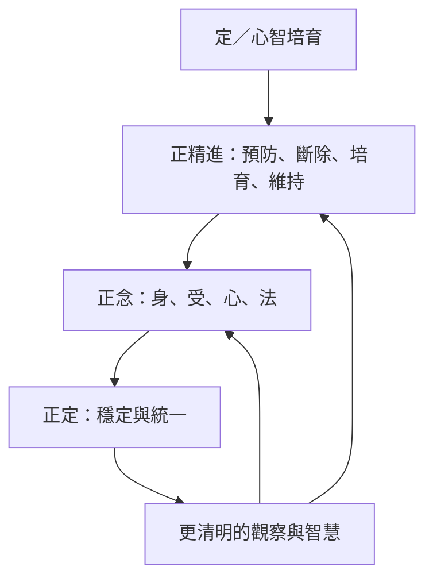

定的三支從培育條件、當下覺察到心的穩定形成一組互補關係。正精進調整善與不善心態的生起，正念觀察身受心法，正定讓心具有持續安住與深入觀察的能力。三者互相支持，但不能把正定簡化為一般專注。

## 思與行
* 練習時分別記錄努力的方向、觀察的對象與心的穩定程度。
* 以長期減少貪瞋癡與傷害作為方向，而非追求特殊經驗或表現。

## 參考
* [[正精進是四種方向明確的心智培育]]、[[正念以身受心法建立完整觀察]]、[[正定在早期經文中以四禪作為典型定義]]。
* 概念：[[正精進]]、[[正念]]、[[正定]]、[[四念處]]、[[禪那]]。
