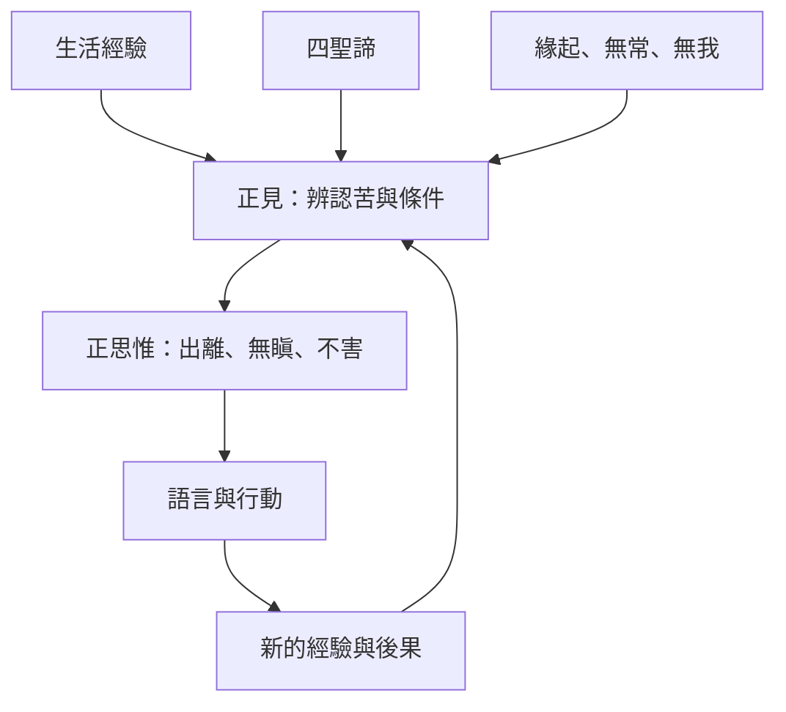

智慧二支提供理解與意向的方向。正見釐清苦、苦的條件與止息之道；正思惟則將理解轉成出離、無瞋與不害的行動意向。理解和意向會反覆互相修正：意向促使人重新觀看，新的觀察又深化理解。

## 思與行
* 在做決定前，先寫出事實、推論、意向與可能後果。
* 把正見視為可深化的理解，而不是一個不可質疑的身份標籤。

## 參考
* [[正見提供修行方向但不是僵化信念]]、[[安貝卡的佛教詮釋把解脫連結自由平等與博愛]]。
* 概念：[[正見]]、[[正思惟]]、[[四聖諦]]、[[緣起]]。
