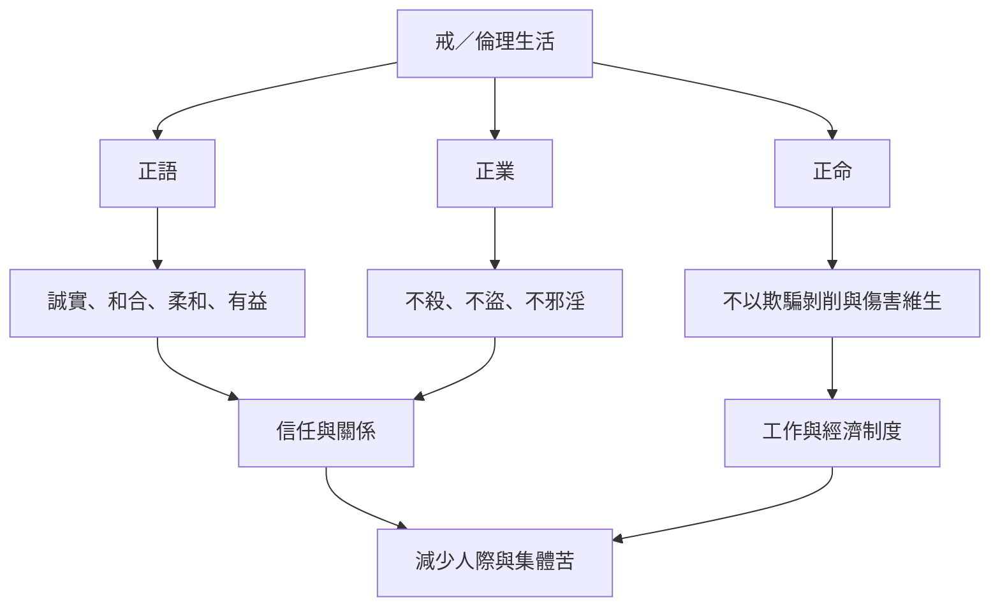

戒的三支把修行放進日常互動與維持生活的方式。正語關乎溝通與信任，正業關乎身體行為與不害，正命則將倫理延伸到工作和經濟關係。三者共同回答：如何在不傷害自己與他人的前提下生活、合作與維持生計？

現代正命分析需要考慮供應鏈和制度影響，不宜只依職業名稱判斷。

## 思與行
* 選一個工作或消費決策，分別從溝通、行為與生計三方面檢查。
* 把個人倫理與組織制度分開描述，避免把結構性問題全推給個人。

## 參考
* [[正語可以從不傷害進一步發展為修復關係]]、[[正命需要檢視工作造成的間接影響]]、[[八正道的社會意義需要同時檢視制度與個人行動]]。
* 概念：[[正語]]、[[正業]]、[[正命]]、[[不害]]。
