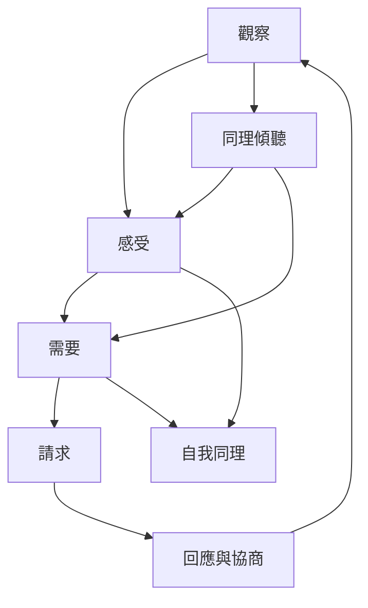

NVC 的核心流程，是從可共同確認的事件開始，辨識感受與需要，再提出允許對方拒絕的具體請求。它既可用於誠實表達，也可用於同理傾聽與自我連結。四個要素不是線性檢核表，而是可往返、可暫停的覺察地圖。

核心筆記：[[NVC是一種關係意識而不是固定話術]]、[[觀察與評價分開能讓衝突回到可共同檢視的事件]]、[[感受是內在經驗的訊號而不是他人造成情緒的證據]]、[[需要是深層價值而策略只是滿足需要的其中一條路]]、[[真正的請求具體可行而且允許對方說不]]。

概念入口：[[非暴力溝通]]、[[四要素]]、[[觀察]]、[[感受]]、[[需要]]、[[請求]]、[[策略]]、[[評價]]。
