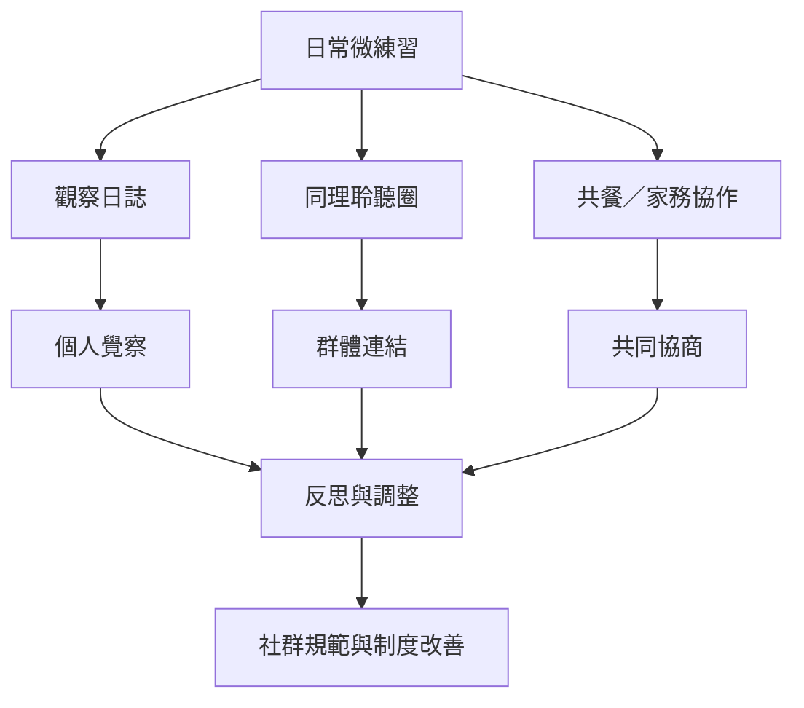

NVC 能否成為可持續的生活文化，取決於練習是否進入日常互動、是否有同儕支持，以及是否能安全地處理失敗與差異。社群應把拒絕權、退出權、輪替主持與透明決策納入設計，而不只追求說話技巧。

延伸實驗：[[以七天觀察日誌練習區分事件與自動評價]]、[[把NVC練習放進共餐與家務協作的真實情境]]、[[用輪流聆聽圈建立不急著給建議的聚會文化]]、[[在小組協議中加入權力透明拒絕權與退出機制]]、[[將內觀的身體覺察與NVC的需要辨識串成反應前的練習]]。
