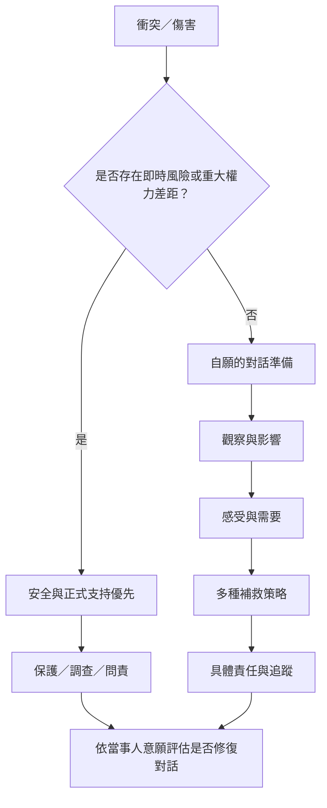

NVC 的非強制精神必須放在權力關係中理解。當人們不能安全拒絕、不能表達異議或承擔報復風險時，單純要求「好好溝通」可能成為語氣規訓。有效的修復需要自願、安全、責任與具體補救。

核心筆記：[[NVC在權力不對等下可能變成語氣規訓]]、[[同理與界線可以同時存在]]、[[NVC不能取代安全措施與正式問責機制]]、[[衝突修復必須建立在自願與安全之上]]、[[同理不能要求受害者承擔修復義務]]。

概念入口：[[權力與非強制]]、[[界線]]、[[安全與問責]]、[[衝突修復]]、[[心理安全]]。
