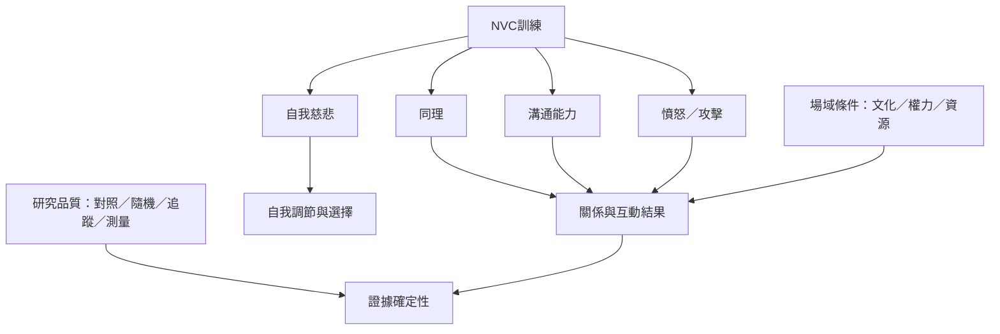

NVC 已出現在健康照護、教育、公共組織、青少年服務與校園輔導等領域。現有研究提供值得探索的訊號，但不同結果的證據品質與研究設計差異很大。應用時須區分實務案例、質性研究、量表研究、控制介入與系統性回顧。

核心筆記：[[NVC的成效應拆分為不同結果而不是籠統宣稱有效]]、[[NVC可以支援照護關係但不能替代制度改善]]、[[教育中的NVC應擴大學生參與而非只管理情緒]]、[[測量NVC時必須區分語言技巧與關係品質]]、[[練習成效需要長期追蹤與多種測量]]。

資料入口：[[2026系統性回顧納入31項量化研究但指出NVC證據仍有不確定性]]、[[2024健康照護範疇回顧整理六國七項NVC研究]]、[[2025南韓護理學生隨機對照研究發現同理與人際關係分數改善]]、[[2025巴西公共組織研究指出NVC可能促進反思與合作但階層仍構成限制]]。
