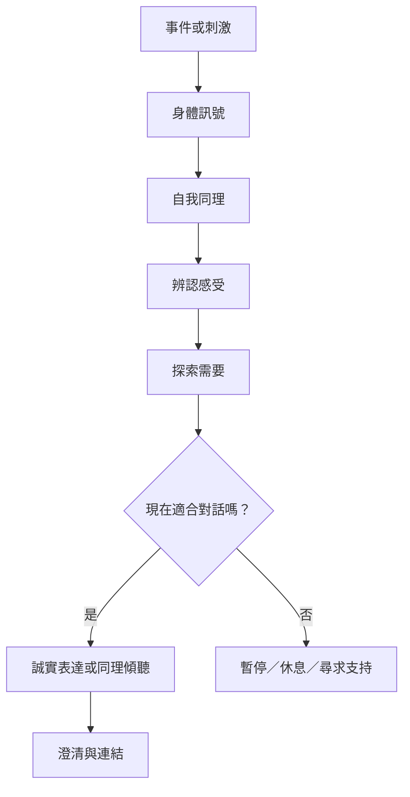

NVC 不只處理對外溝通，也重視人在反應之前如何理解自身經驗。自我同理讓人辨認情緒與需要；同理傾聽則嘗試進入對方的參照框架。兩者都需要好奇、真誠與可修正性，不能淪為代替別人解釋。

核心筆記：[[自我同理能在反應之前創造一點空間]]、[[同理是理解對方的經驗而不是替對方下結論]]、[[同理與界線可以同時存在]]、[[需要提供理解感受的線索但不是唯一原因]]。

概念入口：[[自我同理]]、[[同理]]、[[同理猜測]]、[[感受]]、[[需要]]、[[界線]]。
