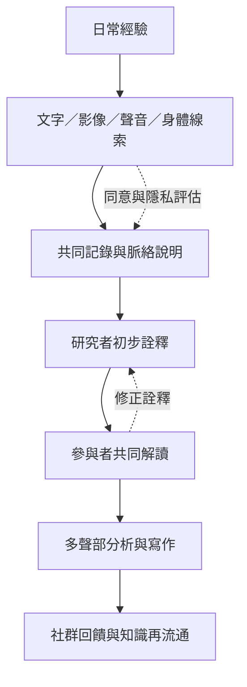

數位文化不只透過文字呈現，也透過影像、聲音、身體感受、介面操作與物件形成。多模態方法需要與參與者協商資料可用範圍，並讓參與者能參與詮釋與成果回饋。

## 關係圖

## 核心筆記
* [[參與者共同詮釋能降低研究者壟斷意義的風險]]
* [[研究成果應回到社群並容許參與者重新詮釋]]
* [[用生活日誌補充貼文資料看不到的日常條件]]
* [[用多模態田野紀錄保留聲音影像與身體線索]]
* [[線上訪談的媒介選擇會改變可說與不可說的內容]]

## 概念詞彙
* [[多模態民族誌]]
* [[厚描]]
* [[參與式研究]]
* [[知情同意]]
* [[反身性]]
* [[數位物質性]]

## 參考脈絡
* 相關文獻請參閱根目錄導讀 [[Online_ethnography]]，並依其中的文獻卡片連結追溯原始來源。
