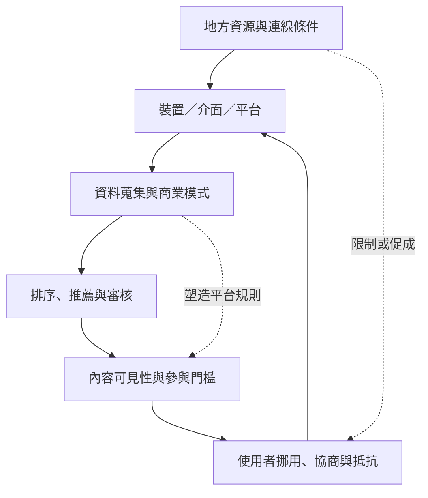

平台不只是田野容器，也是透過商業模式、排序、審核、資料蒐集與技術條件塑造互動的行動者。民族誌能把這些抽象系統放回日常實踐、地方基礎設施與使用者的理解中。

## 關係圖

## 核心筆記
* [[平台功能是在使用情境中被實踐而不是自動產生效果]]
* [[演算法應被研究為日常實踐與制度關係的集合]]
* [[數位民族誌需要把基礎設施納入研究對象]]
* [[把平台停機與帳號消失記為田野事件]]
* [[把低連線與設備共用納入研究設計]]

## 概念詞彙
* [[平台可供性]]
* [[演算法中介]]
* [[數位物質性]]
* [[數位落差]]
* [[基礎設施民族誌]]
* [[數位民族誌]]

## 參考脈絡
* 相關文獻請參閱根目錄導讀 [[Online_ethnography]]，並依其中的文獻卡片連結追溯原始來源。
