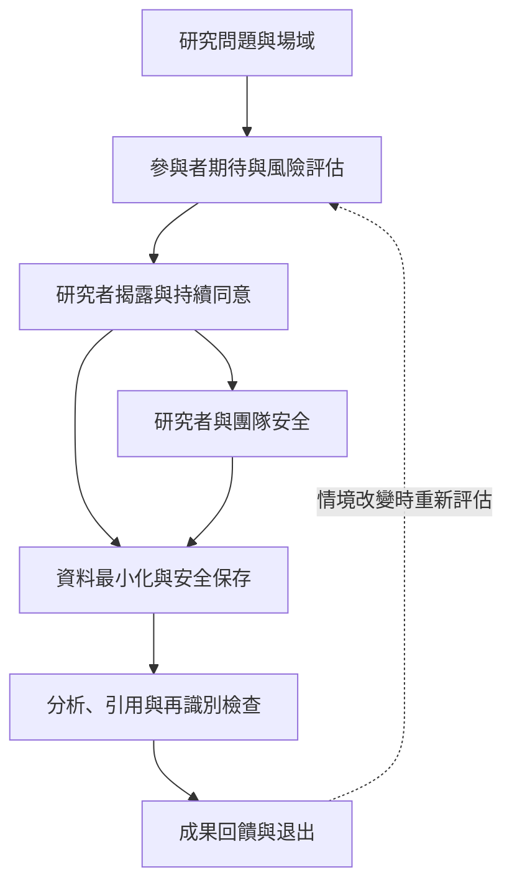

線上研究的倫理風險隨場域、研究者角色與資料用途變動。倫理設計應涵蓋持續同意、研究者透明度、資料最小化、再識別防護、社群期待、研究團隊安全與成果回饋。

## 關係圖

## 核心筆記
* [[數位田野的倫理不能簡化為公開貼文可以任意使用]]
* [[同意應被設計成持續協商而非一次簽署]]
* [[數位痕跡的可搜尋性會增加參與者再識別風險]]
* [[研究者應把平台沉默與退出視為需要解讀的現象]]
* [[為研究團隊建立數位資料照顧與刪除流程]]

## 概念詞彙
* [[知情同意]]
* [[情境完整性]]
* [[數位痕跡]]
* [[研究者位置性]]
* [[反身性]]
* [[參與式研究]]

## 參考脈絡
* 相關文獻請參閱根目錄導讀 [[Online_ethnography]]，並依其中的文獻卡片連結追溯原始來源。
