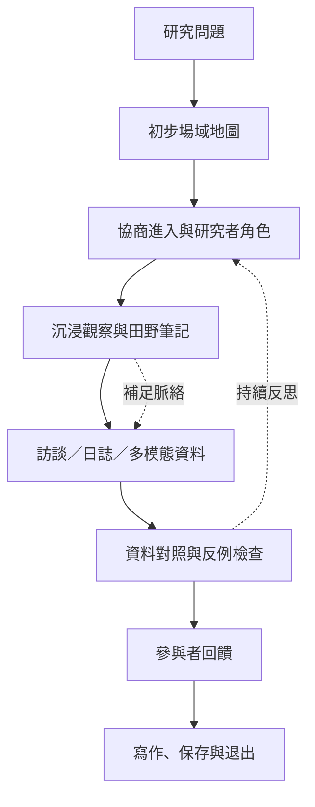

從研究問題出發，界定場域、參與者、研究者角色與研究時間，再透過沉浸、訪談、觀察、資料整理、分析、回饋與退出形成一條可反思的研究流程。方法不是工具清單，而是研究問題、平台特性與參與者日常之間的配對。

## 關係圖

## 核心筆記
* [[田野場域是研究者與參與者共同形成的關係網絡]]
* [[線上觀察必須結合參與者觀點才能避免把痕跡誤認為生活]]
* [[研究者的在場方式會改變社群互動與資料品質]]
* [[線上訪談的媒介選擇會改變可說與不可說的內容]]
* [[數位民族誌的時間尺度需要與平台節奏和生活節奏並行]]
* [[數位民族誌寫作必須呈現推論如何從材料形成]]

## 概念詞彙
* [[田野場域]]
* [[參與觀察]]
* [[民族誌]]
* [[線上民族誌]]
* [[數位民族誌]]
* [[網路民族誌]]
* [[多點民族誌]]
* [[連結式民族誌]]

## 參考脈絡
* 相關文獻請參閱根目錄導讀 [[Online_ethnography]]，並依其中的文獻卡片連結追溯原始來源。
