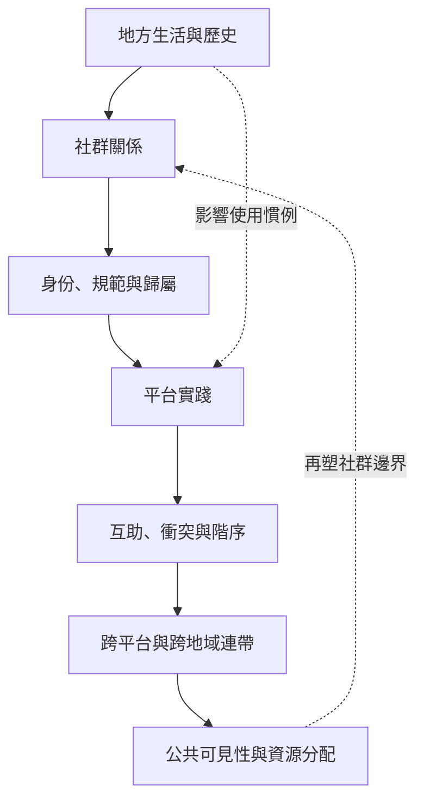

此概念地圖把社群文化放回跨平台關係、地方生活與身份政治之中。研究者要同時觀察歸屬、互助、衝突、階序與跨地域連結，並避免把一個平台、一個國家或少數核心成員當成整體社群。

## 關係圖

## 核心筆記
* [[跨平台田野比單一平台觀察更能呈現社會關係]]
* [[社群內部的互助與階序必須一起被觀察]]
* [[跨文化比較應尋找反例而不是套用通則]]
* [[數位行動的區域連帶仍可能再現中心與邊陲的不平等]]
* [[研究成果應回到社群並容許參與者重新詮釋]]

## 概念詞彙
* [[多點民族誌]]
* [[連結式民族誌]]
* [[情境崩解]]
* [[平台可供性]]
* [[參與式研究]]
* [[研究者位置性]]
* [[數位落差]]

## 參考脈絡
* 相關文獻請參閱根目錄導讀 [[Online_ethnography]]，並依其中的文獻卡片連結追溯原始來源。
