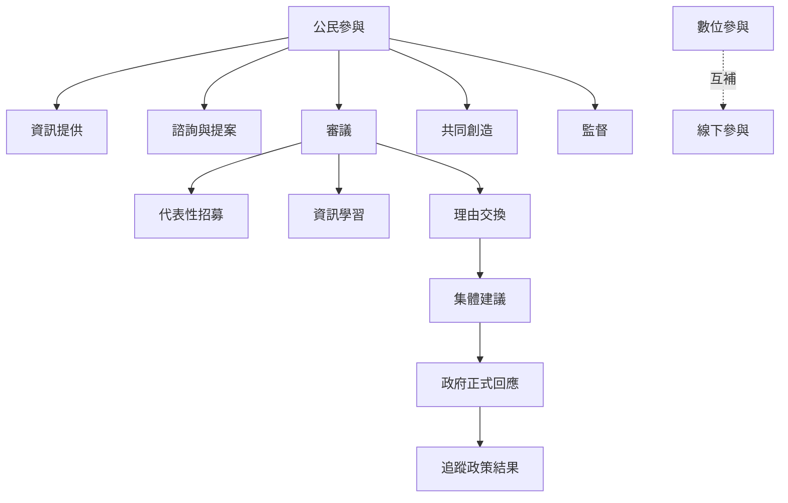

公民參與有不同深度：資訊提供、諮詢、協作、共同決策與公民監督。審議式程序強調代表性、知情與理由交換，數位平台則只是可能的媒介之一。

關鍵概念：[[公民參與]]、[[審議式民主]]、[[公民大會]]、[[共同創造]]、[[數位民主]]、[[數位落差]]、[[包容性參與]]。

延伸：[[公民參與只有連接政策週期才有實質影響]]、[[審議品質不能用平台流量替代]]、[[數位參與需與線下參與互補]]、[[共同創造不等於政府把公權力外包給公民]]。

返回：[[Open_government]]。
