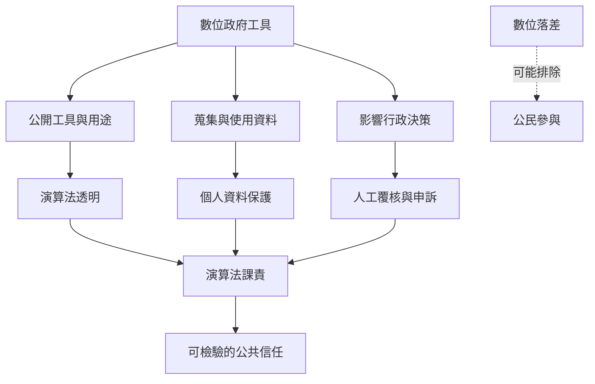

數位工具能擴大參與，也能集中資料、擴大監控或把偏誤嵌入行政流程。開放政府必須同時要求演算法透明、個資保護、資安、可近用性與人工救濟。

關鍵概念：[[數位政府]]、[[數位民主]]、[[演算法透明]]、[[演算法問責]]、[[個人資料保護]]、[[數位權利]]、[[資訊安全]]。

延伸：[[演算法透明需要揭露用途責任與救濟]]、[[資料公開與個人隱私必須共同治理]]、[[數位參與需與線下參與互補]]。

返回：[[Open_government]]。
