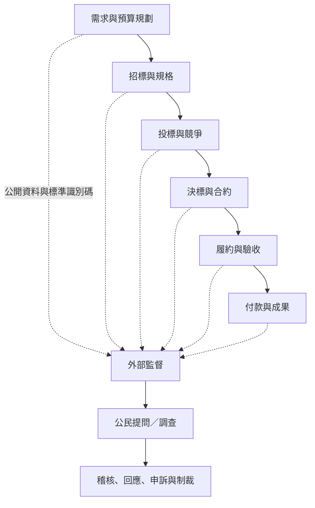

公共採購涉及大量公共資源。開放契約把採購各階段串成可追蹤資料，公民社會與監督機關再將資料轉為問題線索、調查與救濟。

關鍵概念：[[課責]]、[[公共採購]]、[[開放契約]]、[[社會課責]]、[[反貪腐]]、[[廉政]]。

延伸：[[開放契約讓公共採購從公告走向全流程監督]]、[[開放契約讓公共採購全流程成為可監督的資料鏈]]、[[開放政府應以公共問題改善而非平台規模衡量]]。

返回：[[Open_government]]。
