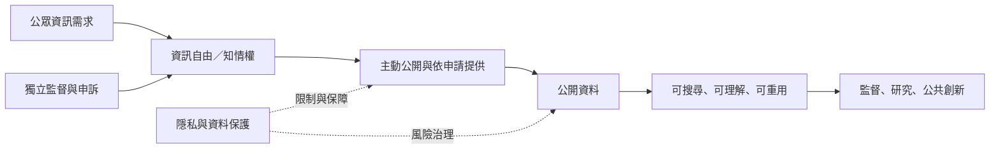

本圖將透明政策、資訊自由、開放資料與個資保護放在同一條治理鏈上。資訊公開的目的，是讓公眾能理解並再利用；但公開方式仍須保護個人權利。

關鍵概念：[[透明度]]、[[資訊自由]]、[[公開資料]]、[[開放資料]]、[[資料治理]]、[[資料互通性]]、[[個人資料保護]]。

延伸：[[透明化若沒有公民使用情境就可能退化為資訊傾倒]]、[[公開資料的價值取決於可用性和再利用]]、[[法律上的資訊權需要獨立監督和有效救濟]]、[[資料公開與個人隱私必須共同治理]]。

返回：[[Open_government]]。
