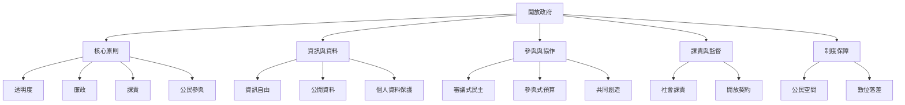

本圖將開放政府整理成五個互相依賴的系統：原則、資訊、參與、課責與制度保障。閱讀時可以從 [[開放政府必須同時改變資訊流與決策權力]] 進入，再依問題深入各分圖。

核心概念：[[開放政府]]、[[透明度]]、[[課責]]、[[公民參與]]、[[廉政]]。

核心閱讀：[[開放政府必須同時改變資訊流與決策權力]]、[[開放政府應以公共問題改善而非平台規模衡量]]。

資料來源：[[開放政府需要透明廉正課責與參與的整體制度]]、[[開放政府研究偏重透明而較少驗證參與成效]]、[[全球資訊近用法律增加但落實仍存在落差]]。

返回：[[Open_government]]。
