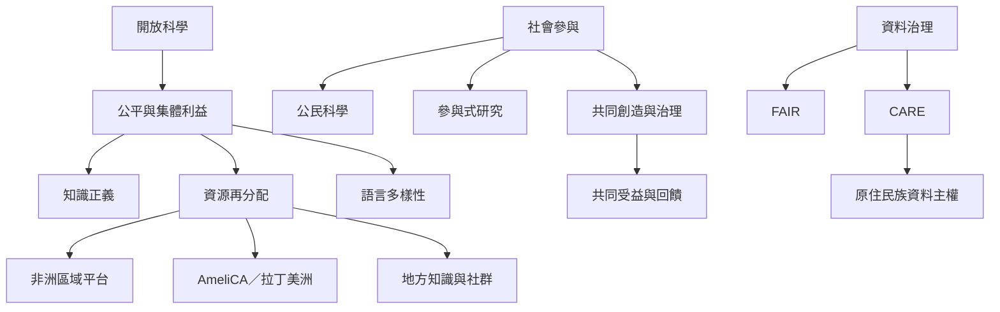

公平的開放科學不只是擴大資訊流通，也要讓不同社群參與問題設定、資料治理、成果詮釋與利益分配。此圖將地方參與、知識正義、原住民族權利及全球南方的基礎建設放在同一張圖中。

以[[公民科學應共享問題設定權而不只是提供資料]]作為參與檢核，以[[開放科學必須承認不同知識體系的自主性]]作為倫理前提，再以[[全球南方的開放科學需要資源再分配與共同治理]]補足結構性條件。

---

返回導讀：[[Open_science]]
