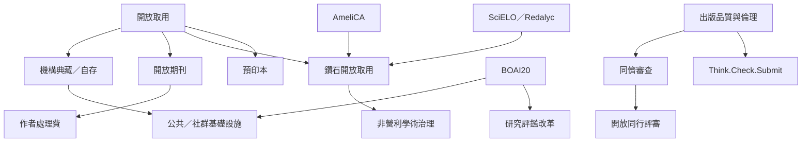

開放出版同時涉及讀者可近用、作者發表門檻、出版品質與基礎設施控制權。不同出版路徑不應只以「免費」與否判斷，而要看成本由誰承擔、制度由誰治理。

核心論點是[[開放取用不能只把付費牆改成作者付費牆]]，以及[[開放取用不自動代表出版品質可信]]。全球案例可參照 [[BOAI20_Budapest_Open_Access_Initiative]]、[[AmeliCA_Latin_American_Open_Science]] 與 [[India_One_Nation_One_Subscription]]。

---

返回導讀：[[Open_science]]
