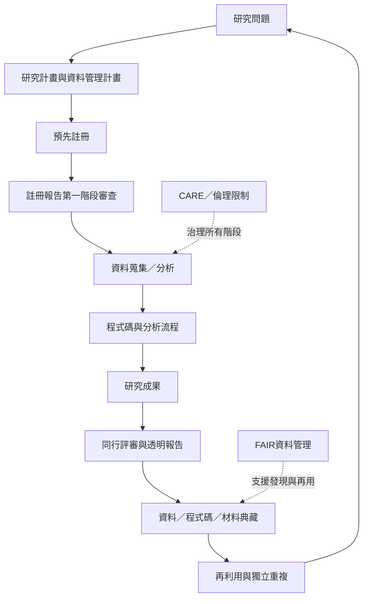

研究透明度需要在研究開始前、執行中與發表後共同建立。此圖整理資料管理、預先註冊、註冊報告、研究軟體與重複驗證的關係。

這張圖的關鍵不是把每一步都無條件公開，而是讓每一步有可追溯記錄及明確例外。參照 [[資料應盡可能開放但必須符合必要限制]]、[[預先註冊能區分驗證性與探索性分析]] 與 [[註冊報告把研究品質審查提前到結果出現之前]]。

---

返回導讀：[[Open_science]]
