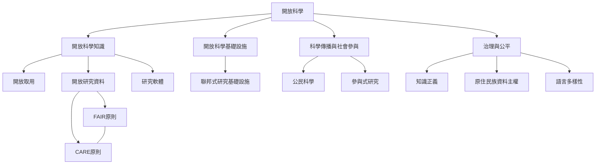

開放科學是一個由知識原則、研究實踐、基礎設施、制度誘因與社會關係組成的生態。此圖呈現由核心概念向研究流程、出版制度與社會參與的連結。

閱讀時先理解[[開放科學不只是公開成果而是開放整個知識循環]]，再進入[[FAIR與CARE應共同指引資料治理]]與[[全球南方的開放科學需要資源再分配與共同治理]]。此圖也連結 [[Open_science]] 導讀與 [[開放科學]] 術語。

---

返回導讀：[[Open_science]]
