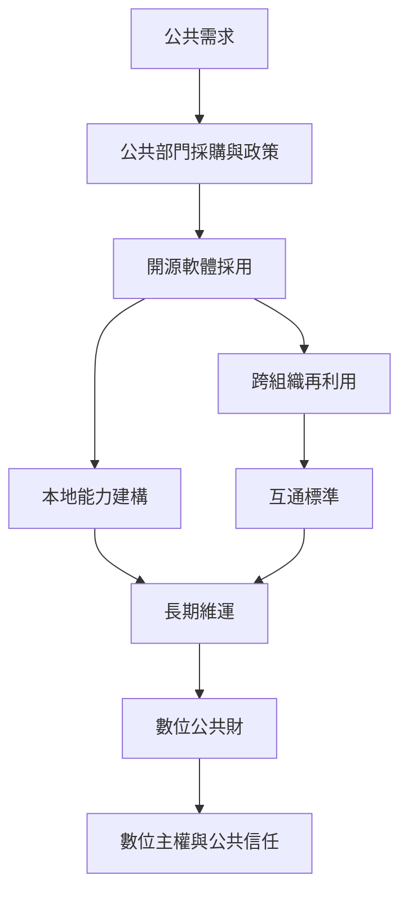

開源進入公共部門後，問題從「能否下載程式碼」擴展為採購、數位自主、跨機關協作、地方能力與公共問責。巴西、印度與歐洲案例呈現不同制度路徑。

可先讀[[公共部門採用開源需要本地能力與長期維運]]，再比較[[巴西公共軟體入口網站展示政府共享程式的制度可能]]與[[歐洲地方政府案例顯示跨域再利用需要共同維護]]。

參照：[[數位公共財]]、[[數位主權]]、[[開源計畫辦公室]]、[[軟體物料清單]]。
