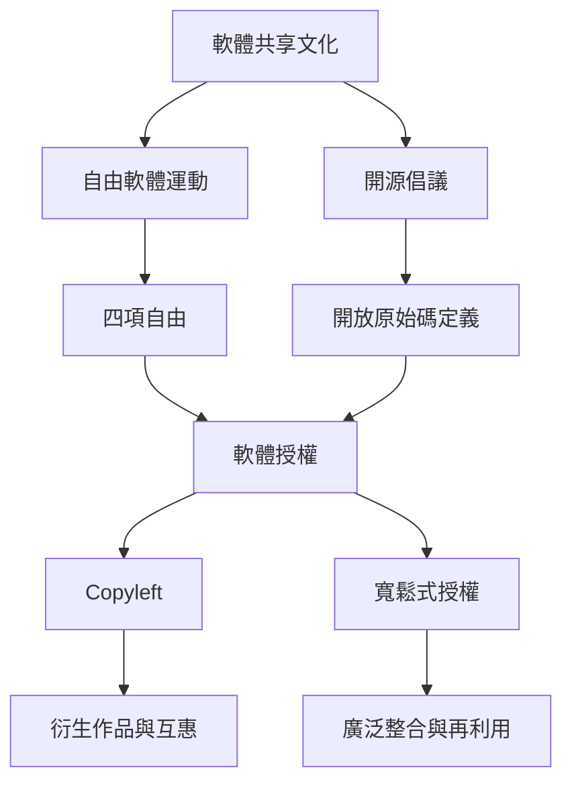

開源思想從自由軟體運動與共享文化發展而來，後來形成 OSI 的開源定義與授權審查制度。概念地圖的核心不是把所有開源活動視為同一價值，而是追蹤「權利—授權—實作—社群」之間的關係。

可沿[[自由軟體運動與開源運動同源但價值論述不同]]理解兩種運動的價值差異，再讀[[開放不等於公開原始碼而是可行使的權利]]與[[軟體授權決定開放如何被制度化]]。

參照：[[開放原始碼定義]]、[[自由軟體]]、[[開放原始碼軟體]]、[[Copyleft]]、[[寬鬆式授權]]、[[原始碼]]。
