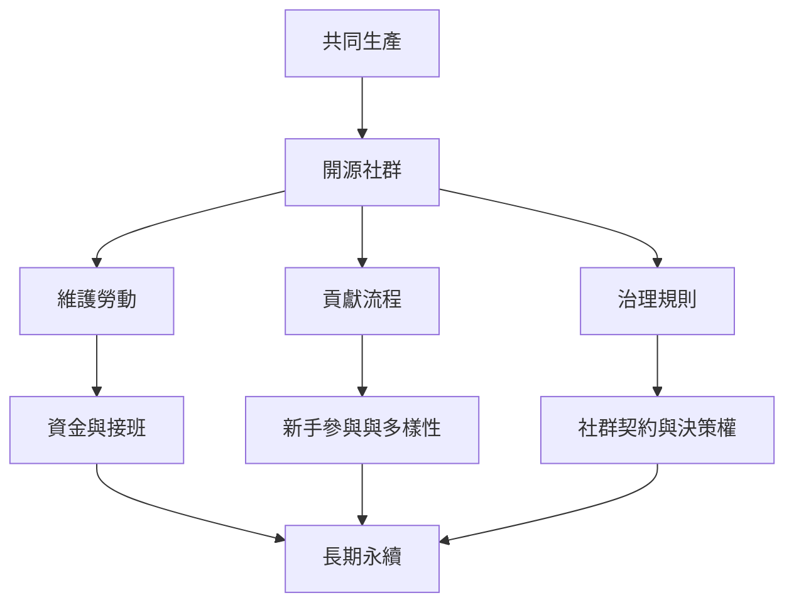

開源社群依賴正式規則與非正式慣例共同運作；其長期健康取決於維護勞動、權力分配、資金、接班與參與者體驗。

理解[[共同資源需要治理規則而不是假設人人自律]]，並連結[[維護者的隱形勞動是數位基礎設施的一部分]]、[[開源永續需要把維護工作納入預算]]及[[開源參與的全球化不等於機會平等]]。

參照：[[開源治理]]、[[社群契約]]、[[共同生產]]、[[數位公地]]、[[開源計畫辦公室]]。
