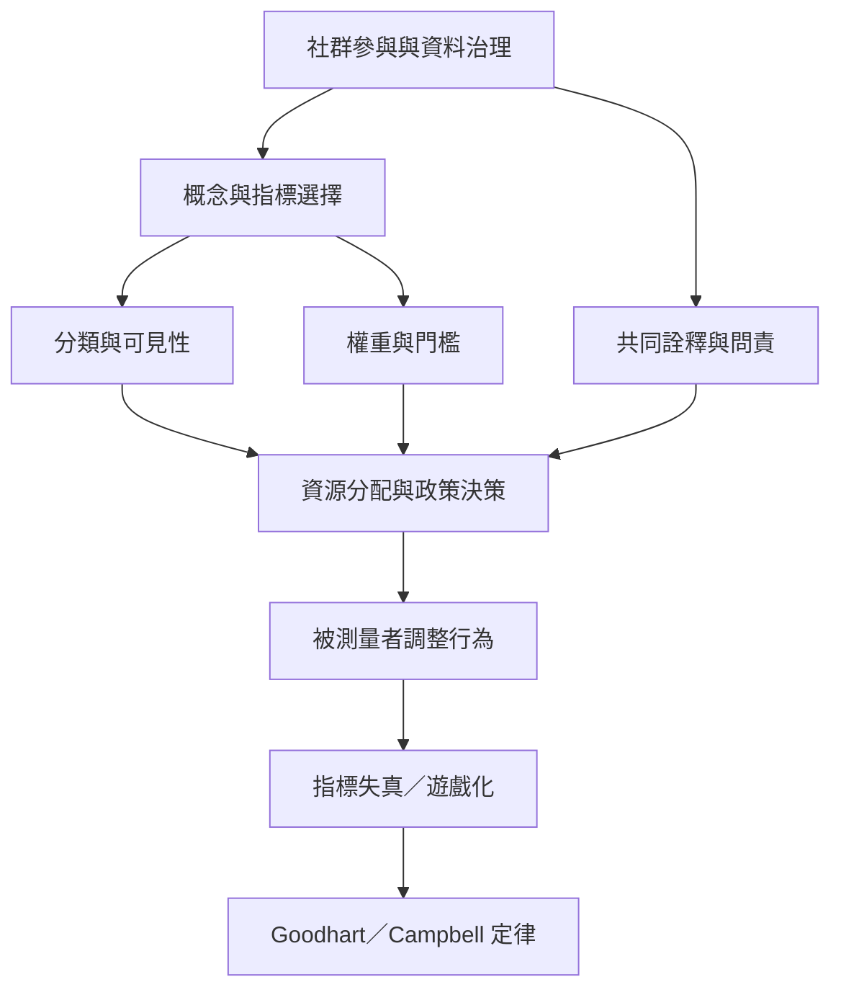

指標不是中性的鏡子。分類與權重反映價值選擇，政策使用會改變被測量者行為，而制度權力決定誰能定義與使用資料。[[Goodhart 定律]]、[[Campbell 定律]]與[[參與式研究]]有助於分析操作化的社會後果。

概念連結：[[Goodhart 定律]]、[[Campbell 定律]]、[[社會指標]]、[[複合指標]]、[[參與式研究]]、[[在地知識]]、[[被測量群體應參與定義何謂重要指標]]
