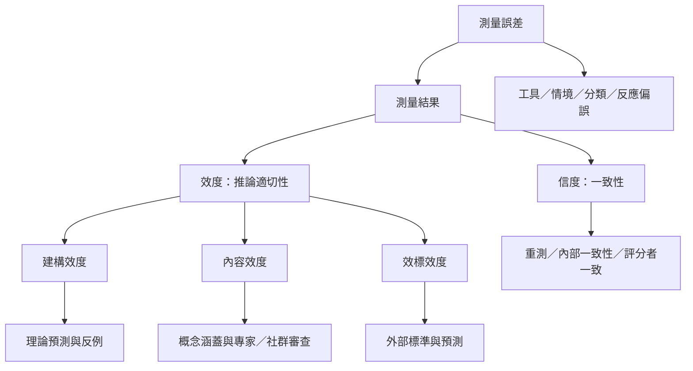

測量品質需要多種不同證據。[[信度]]關心一致性，[[效度]]關心推論是否合理；[[建構效度]]連結理論網絡，[[內容效度]]檢查涵蓋範圍，[[效標效度]]檢查外部關係。[[測量誤差]]可能來自工具、情境、分類、作答風格或研究者判讀。

概念連結：[[效度]]、[[信度]]、[[建構效度]]、[[內容效度]]、[[效標效度]]、[[測量誤差]]、[[反應偏誤]]、[[建構效度是可修正的論證而不是固定標籤]]
