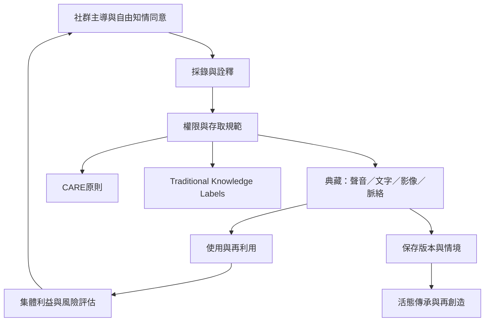

口述傳統的保存必須同時考慮文化活力、社群權限與資料治理。數位錄音和開放典藏能增加可保存性，卻也可能使敏感知識脫離原來的關係與規範。倫理不是上傳後才補上的說明，而應從研究設計開始。

## 關係圖

## 導讀
* [[非物質文化遺產]]、[[原住民族知識]]、[[數位主權]]、[[傳統知識標籤]]
* [[知識保存必須讓來源社群保有治理權]]
* [[數位可取得性不等於倫理上可以再利用]]
* [[保護口述傳統的目標應是支持持續再創造而非凍結版本]]
* [[把口述典藏設計成保留聲音脈絡與使用權限的知識庫]]

## 主要依據
* [[加拿大原住民族研究倫理要求研究者尊重口傳文化中的知識限制]]
* [[CARE原則與傳統知識標籤讓數位典藏尊重原住民族治理]]
* [[UNESCO倡議保存文化傳統時不可把活態實踐凍結]]
