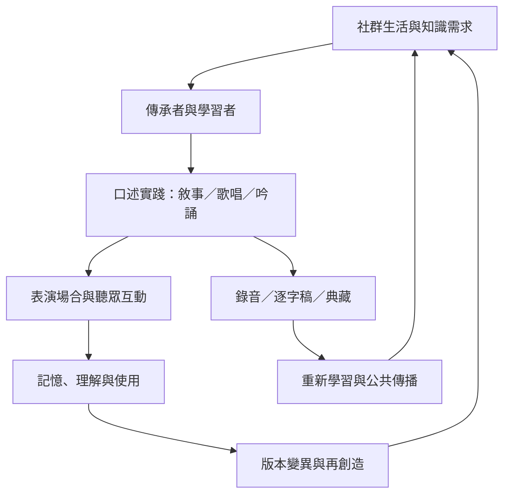

口述傳統由社群關係、講述者、聽眾、場合、記憶技術與語言共同維持；傳承過程會產生變異，並透過持續實踐形成新的社會意義。

## 關係圖

## 導讀
* [[口述傳統]]、[[代際傳承]]、[[文化記憶]]、[[傳承者]]
* [[口述傳統是一個同時包含訊息與傳承過程的系統]]
* [[版本差異是口述傳承的生命跡象而不必然是錯誤]]
* [[保護口述傳統的目標應是支持持續再創造而非凍結版本]]
* [[讓語言傳承發生在共同生活而非只有課堂]]

## 參考
* [[口述傳統是持續變動的活態文化而非固定文本]]
* [[凡西納指出口述傳統必須作為傳承鏈來批判性分析]]
* [[芬尼根證明非洲口述文學具有多樣形式與社會功能]]
