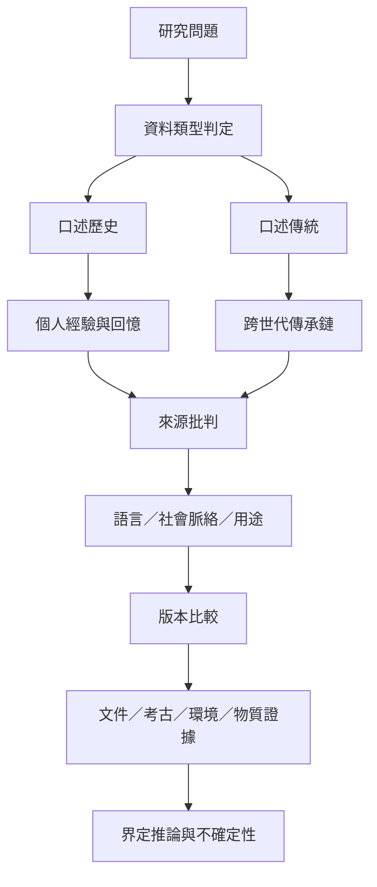

口述資料的分析應從研究問題開始，辨認資料類型、傳承距離、來源鏈、敘事功能與版本差異，再決定如何與其他證據互相參照。不同的口述資料能支持不同類型的歷史與文化主張。

## 關係圖

## 導讀
* [[口述歷史]]、[[口述資料]]、[[集體記憶]]、[[文化記憶]]
* [[口述歷史與口述傳統回答的時間尺度不同]]
* [[口述資料的可信度取決於問題、傳承鏈與交叉驗證]]
* [[書寫與標準化會重新分配傳統的權威]]
* [[原住民族敘事不應被預先降格為非知識]]

## 區域案例
* [[澳洲原住民族沿海故事可能保存七千年以上的海岸變遷記憶]]
* [[太平洋島嶼史學必須將口述傳統納入歷史證據]]
* [[安地斯克丘亞語故事研究顯示傳統會在鄰近社群間互相演化]]
* [[臺灣達悟族歌謠承載歷史生活故事與禁忌知識]]
