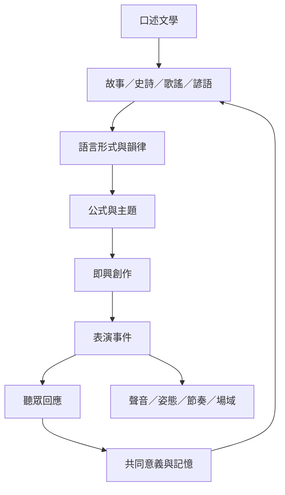

口述作品是特定語言藝術在具體情境中的實踐。聲音形式、敘事慣例、身體、聽眾與社會規範會共同形塑作品，因此分析時應從表演事件理解其意義。

## 關係圖

## 導讀
* [[口述文學]]、[[表演理論]]、[[口傳公式理論]]、[[故事講述]]
* [[表演事件讓口述作品在每次講述中重新生成]]
* [[聽眾是口述傳統的共同參與者]]
* [[口傳公式讓記憶與即興創作互相支援]]
* [[口述文學的意義存在於語言場合與社會功能的交會]]

## 區域案例
* [[帕里指出公式化語言能支援史詩即興創作]]
* [[印度吠陀吟誦顯示口傳可透過訓練維持高度精確]]
* [[奈及利亞Ifa系統把歷史哲學與生活知識編入吟誦詩句]]
* [[韓國盤索里顯示制度化保存可能壓縮即興空間]]
* [[日本民俗學研究將口承理解為語言實踐與說故事行動]]
