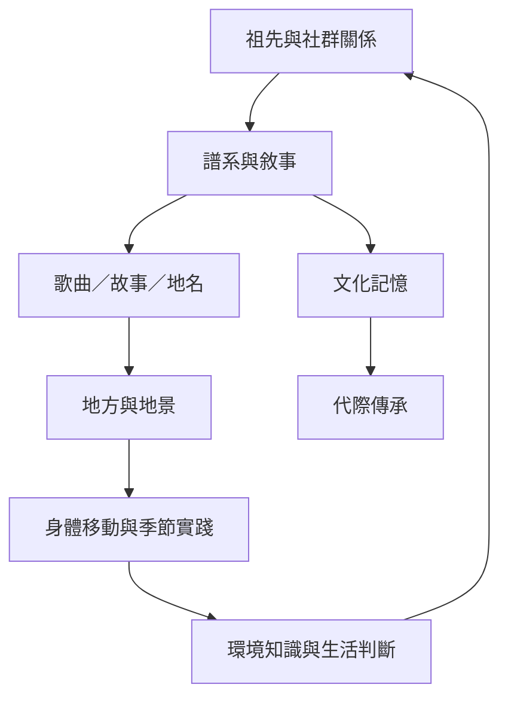

在部分原住民族知識系統中，記憶不是抽象地存放於文字或個人腦中，而是與祖先、地景、身體、物種、語言、歌唱和社群責任互相連結。研究者需先理解地方知識的分類與權限，再選擇合適的分析方式。

## 關係圖

## 導讀
* [[原住民族知識]]、[[歌路線]]、[[毛利知識]]、[[毛利譜系]]、[[毛利故事]]
* [[地方能成為記憶的索引而不只是故事背景]]
* [[原住民族敘事不應被預先降格為非知識]]
* [[臺灣達悟族歌謠承載歷史生活故事與禁忌知識]]

## 區域案例
* [[澳洲Songlines把故事聲音與土地構成可行走的記憶系統]]
* [[毛利知識體系將故事譜系與自然觀連結成方法論]]
* [[澳洲原住民族沿海故事可能保存七千年以上的海岸變遷記憶]]
* [[太平洋島嶼史學必須將口述傳統納入歷史證據]]
