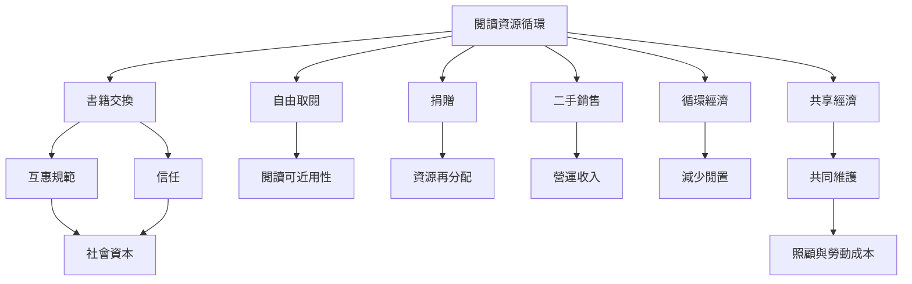

交換閱讀是文化物品循環的一種形式，但不同制度會在互惠、公平、收入與維護成本之間做出不同選擇。自由取閱降低門檻，捐贈擴大供給，二手銷售提供現金流，交換則建立參與者之間的回饋關係。

制度選擇必須考慮社區資源條件。[[交換制度仰賴信任但不應排除沒有資源的人]]是交換型服務的必要原則，而不是附加慈善。

## 參考
- [[鄰里自由書架研究發現互惠規範能支持非貨幣換書]]、[[南澳Oxfam二手書店以捐書與志工支持公益]]、[[小型免費圖書館計畫試圖補足閱讀資源不足的社區]]、[[丹麥永續圖書館研究提醒共享服務需要組織條件]]。
- [[書籍交換]]、[[共享經濟]]、[[循環經濟]]、[[社會資本]]。
- [[設計無書可換者也能參與的多入口閱讀交換制度]]、[[建立有機書店的勞動與志工照顧公約]]。
