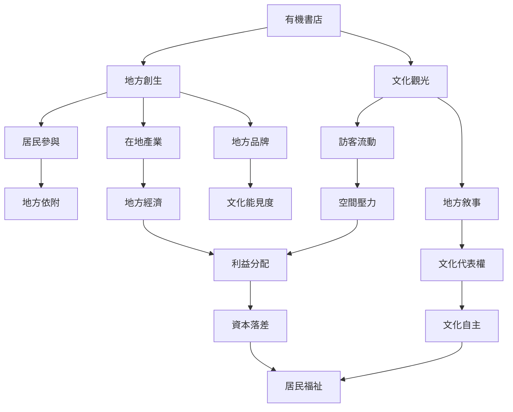

書店可能成為地方轉型的觸媒：先以文化空間吸引注意，再串聯地方商家、創作者與居民。然而觀光成長同時帶來資源再分配與生活壓力，因此需要從居民參與、地方依附、文化保存與資本公平角度檢視。

地方發展必須同時看見正向效益與風險。[[地方創生應以居民參與而非觀光人次衡量]]，並且要檢查[[觀光化可能讓地方文化資源產生新的資本落差]]。

## 參考
- [[中國鄉村書店研究呈現書店帶動村落觀光的三階段]]、[[屏東獨立書店研究提醒地方創生資源分配可能不平等]]、[[石店子69以換書與老屋活化連結關西地方文化]]。
- [[地方創生]]、[[文化觀光]]、[[地方依附]]、[[社區營造]]、[[社會創新]]。
- [[把書店旅行轉化為居民帶路的地方故事交換]]、[[用關係指標評估書店創造的社會價值]]。
