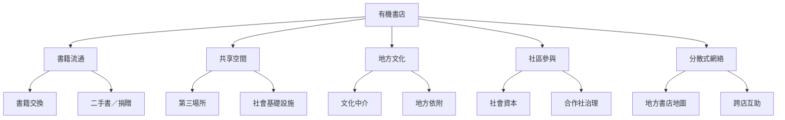

有機書店可被理解為由書籍、空間、工作者、讀者、地方組織與公共機構共同構成的文化生態系。書籍交換只是其中一種資源流動方式；更重要的是讓不同節點之間產生關係、互助與地方知識。

核心問題不是每間店做多少活動，而是[[有機書店不是單一店型而是一種地方文化實踐]]如何在不同地方長出適合自己的關係與服務。

## 參考
- [[有機書店地圖把分散據點連成閱讀旅行網絡]]、[[石店子69以換書與老屋活化連結關西地方文化]]、[[分散式書店網絡能讓地方閱讀資源彼此可見]]、[[書店可以成為街區資訊的公共入口]]。
- [[有機書店]]、[[獨立書店]]、[[社區營造]]、[[文化中介]]。
- [[以書籍旅程護照讓交換閱讀跨越不同地方]]、[[為有機書店網絡建立互助而非排名的共享工具箱]]。
