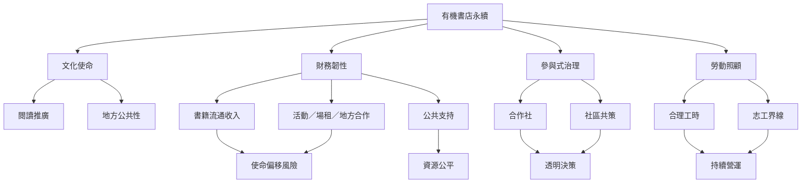

有機書店的長期存續需要同時處理使命、收入、治理與照顧勞動。多元收入能增加韌性，合作社或社區持有可以分散責任，但兩者都需要透明制度與清楚的工作邊界。

核心不是把書店做大，而是讓它在不耗損少數人的情況下持續服務地方。[[文化場域的營運韌性來自多元收入與清楚使命]]必須與[[共享服務需要被看見的照顧與維護勞動]]一起閱讀。

## 參考
- [[October Books以合作社與社區投入完成書店搬遷]]、[[英國社區持有書店案例說明社區股份能支持公共使命]]、[[台灣獨立書店地方創生研究呈現多元擴散路徑]]。
- [[合作社]]、[[社會企業]]、[[社會創新]]、[[社區營造]]。
- [[用社區共策會議讓居民參與書店活動與空間規則]]、[[建立有機書店的勞動與志工照顧公約]]。
