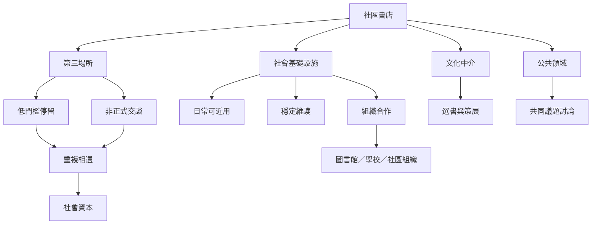

社區書店能否成為公共生活的一部分，取決於它是否讓人能反覆使用、自由參與、取得地方資訊與建立跨群體關係。第三場所理論關心日常交往條件，社會基礎設施則把焦點擴大到支撐互動的空間、組織與制度。

書店不能只用裝潢或活動數量證明公共性。[[書店可以成為第三場所但不會自動平等]]，且[[社會基礎設施要靠日常使用而不是建築外觀成立]]。

## 參考
- [[英國獨立書店研究指出小而慢的零售能產生社會連結]]、[[美國書店的社區角色同時是文化實踐與市場敘事]]、[[October Books以合作社與社區投入完成書店搬遷]]。
- [[第三場所]]、[[社會基礎設施]]、[[社會資本]]、[[公共領域]]、[[文化中介]]。
- [[把共讀讀書會設計成居民可自由加入的日常節奏]]、[[用社區共策會議讓居民參與書店活動與空間規則]]。
