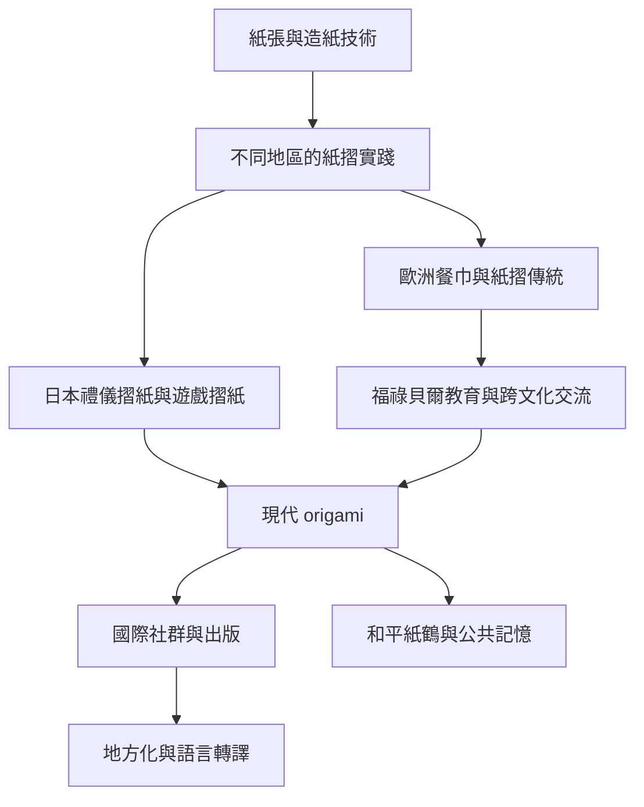

本概念地圖聚焦紙張技術、地方紙摺實踐、儀式、語言與全球傳播。研究摺紙史時，應將「紙張技術的移動」與「摺紙形式的起源」分開，不以一條民族起源敘事涵蓋所有區域。

核心線索：[[摺紙史應以多條文化脈絡與不完整史料來理解]]、[[日本摺紙由禮儀包裝與民間遊戲逐步形成現代形式]]、[[歐洲紙摺傳統具有自身的實用與宴席歷史]]、[[福祿貝爾幼兒教育把摺紙轉化為幾何與手作課程]]、[[廣島紙鶴把個人故事轉化為跨國和平記憶]]、[[全球摺紙社群由地方社團與跨國交流網絡共同構成]]。

## 雙向連結
* 相關概念：[[Origami（摺紙）]]、[[Orikata／Origata（日本禮儀摺紙）]]、[[Washi（和紙）]]、[[Papiroflexia（西班牙語紙摺）]]、[[Pajarita（西班牙紙鳥）]]、[[Froebel occupations（福祿貝爾作業活動）]]、[[Peace crane（和平紙鶴）]]。
* 延伸思考：[[摺紙的全球化是文化轉譯而非單向輸出]]、[[摺紙的文化意義由用途材料與儀式共同形成]]。
