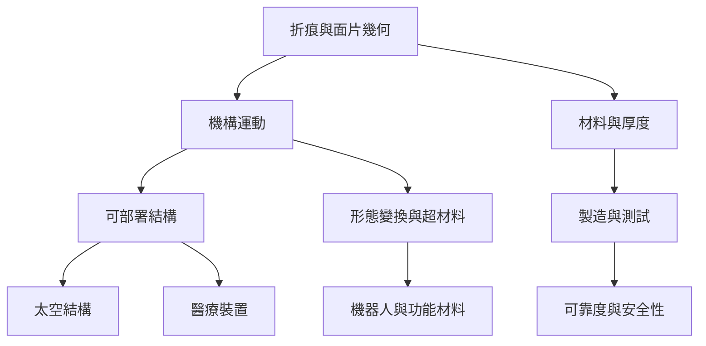

摺紙工程把折痕當成可控制的運動結構，將二維材料轉成可部署、可壓縮或可變形的三維系統。工程應用同時受到幾何、材料厚度、製程誤差、疲勞與使用環境限制。

核心筆記：[[摺紙工程的核心是把折痕設計成可控的運動機構]]、[[工程摺紙必須處理紙面以外的材料厚度與製造限制]]、[[摺疊結構能在收納效率與承載穩定性之間取捨]]。

## 雙向連結
* 相關概念：[[Rigid origami（剛性摺紙）]]、[[Miura-ori（米烏拉摺法）]]、[[Kresling pattern（克雷斯林摺疊圖樣）]]、[[Paper engineering（紙藝工程）]]、[[Kirigami（切紙工藝）]]。
* 案例：[[Miura 摺法顯示紙摺幾何可用於太空部署結構]]、[[醫療摺紙研究聚焦於微小空間中的展開與操作]]。
