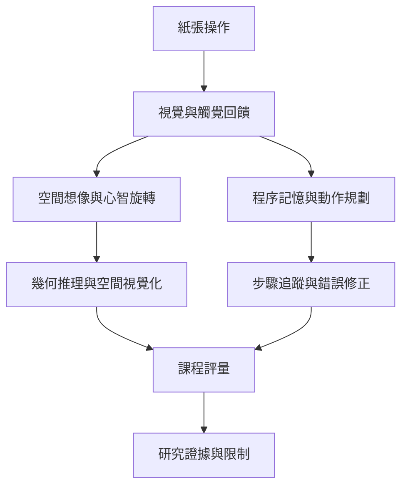

摺紙教學的價值在於讓抽象形式透過手部操作、視覺預測和錯誤修正變得可感知；但教育與認知研究必須以具體指標評估，不能把活動有趣或受歡迎直接等同於認知療效。

核心筆記：[[摺紙能讓幾何關係變成可觸摸的經驗]]、[[摺紙教學的效果取決於任務設計而非摺紙本身]]、[[摺紙可作為認知刺激活動但不能直接等同臨床治療]]。

## 雙向連結
* 相關概念：[[Spatial visualization（空間視覺化）]]、[[Embodied cognition（具身認知）]]、[[Froebel occupations（福祿貝爾作業活動）]]。
* 研究依據：[[摺紙教學研究呈現空間能力潛力但學習成效並不一致]]、[[2025 年系統性回顧顯示摺紙認知介入證據仍然有限]]。
