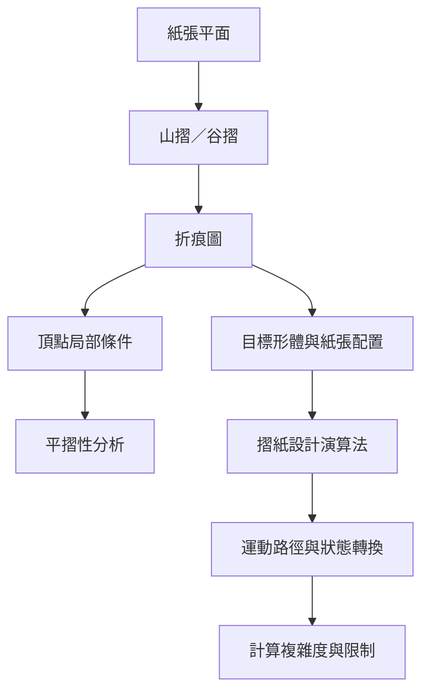

此地圖將手作中隱含的折痕結構轉化為幾何、拓樸與演算法問題。從基礎摺法、頂點條件與平摺性，到演算法設計與計算複雜度，形成一條由局部操作通往整體模型的研究路徑。

核心筆記：[[折痕把平面編碼為可轉換的結構]]、[[摺紙的折痕圖是幾何拓樸與運動規劃的交界]]、[[摺紙設計可以從目標形體反推紙張配置]]、[[計算摺紙讓創作成為可檢驗的演算法流程]]。

## 雙向連結
* 相關概念：[[Crease pattern（折痕圖）]]、[[Mountain fold（山摺）]]、[[Valley fold（谷摺）]]、[[Flat-foldability（平摺性）]]、[[Huzita–Hatori axioms（摺紙公理）]]、[[Kawasaki theorem（川崎定理）]]、[[Maekawa theorem（前川定理）]]、[[Computational origami（計算摺紙）]]。
* 延伸閱讀：[[幾何摺紙專書以模型練習連結數學形式]]、[[計算複雜度提醒我們一般摺紙設計不會有萬用捷徑]]。
