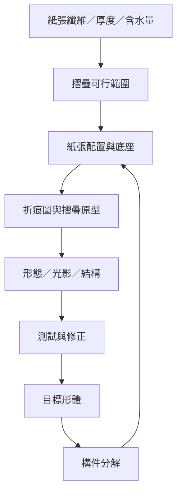

材料、形體與設計方法彼此影響：紙材決定折痕品質，目標形體決定紙張配置，折痕結構又影響模型的運動、穩定與視覺表現。

## 雙向連結
* 核心筆記：[[材料限制會反過來成為摺紙創作的風格來源]]、[[摺紙設計可以從目標形體反推紙張配置]]、[[摺紙工程中的幾何模型必須經過原型與性能驗證]]。
* 相關概念：[[Washi（和紙）]]、[[Crease pattern（折痕圖）]]、[[Wet-folding（濕折法）]]、[[Base（基本形／底座）]]。
