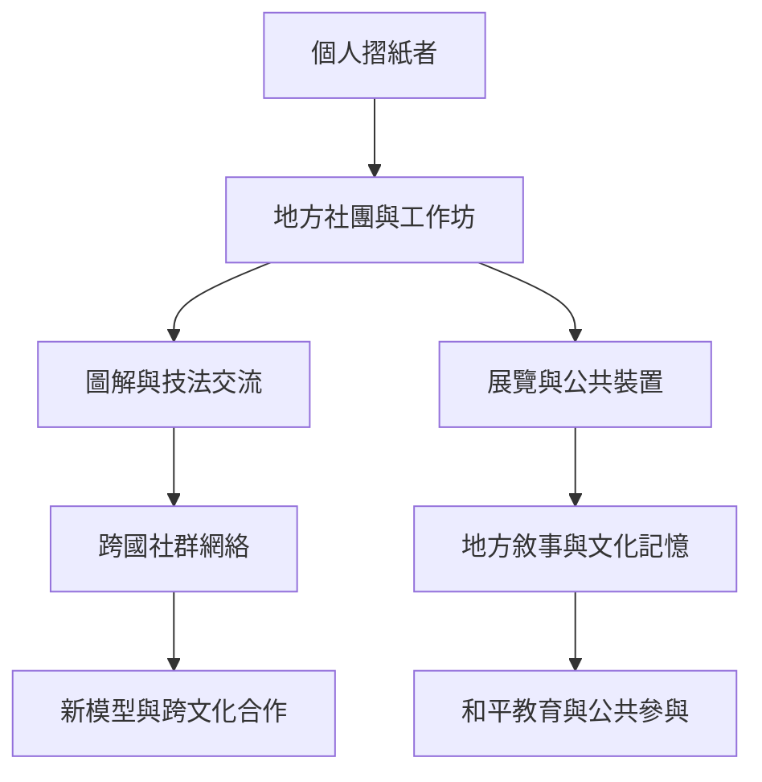

摺紙既是個人手作，也是社群共享的知識和集體行動。社群透過圖解、工作坊、展覽與國際會議傳遞技法；紙鶴、模組裝置與公共藝術則讓摺紙進入和平教育、地方敘事與空間設計。

核心筆記：[[摺紙的文化意義由用途材料與儀式共同形成]]、[[摺紙的全球社群讓技藝成為可共同編修的知識]]、[[紙鶴的意義來自共同記憶而不只是造型]]。

## 雙向連結
* 相關概念：[[Modular origami（模組摺紙）]]、[[Peace crane（和平紙鶴）]]、[[Origami（摺紙）]]。
* 延伸行動：[[用社區共摺作品把個人紙片連成公共裝置]]、[[將地方摺紙故事整理成多語言口述歷史地圖]]、[[建立摺紙社群的開放圖解授權與創作者署名慣例]]。
