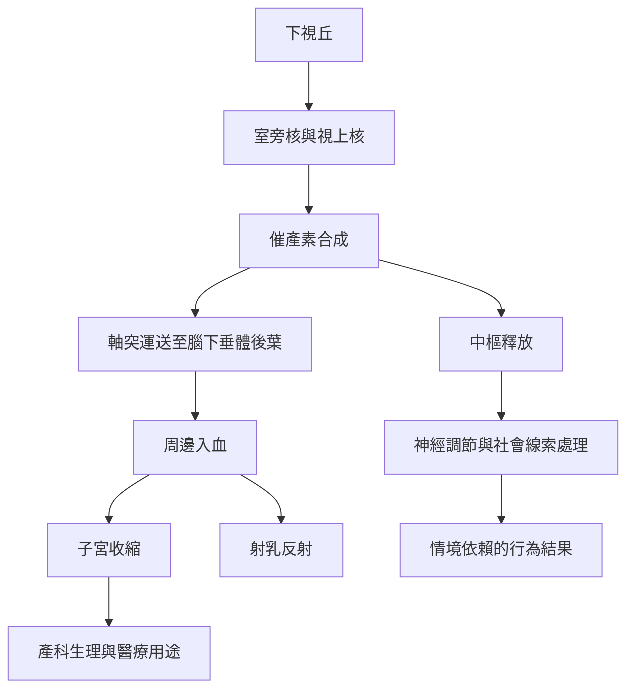

催產素的生理路徑從下視丘合成開始，經由中樞釋放與腦下垂體後葉入血兩種主要通道，連結腦內神經調節與周邊器官功能。需特別區分催產素合成、儲存、釋放與受體作用。

核心概念：[[催產素]]、[[神經肽]]、[[下視丘]]、[[室旁核]]、[[視上核]]、[[腦下垂體後葉]]、[[催產素受體]]、[[中樞催產素]]、[[周邊催產素]]、[[加壓素]]、[[多巴胺]]、[[子宮收縮]]、[[射乳反射]]。

延伸筆記：[[催產素由下視丘合成並透過中樞與周邊路徑發揮作用]]、[[催產素透過子宮收縮與射乳反射發揮重要周邊功能]]。
