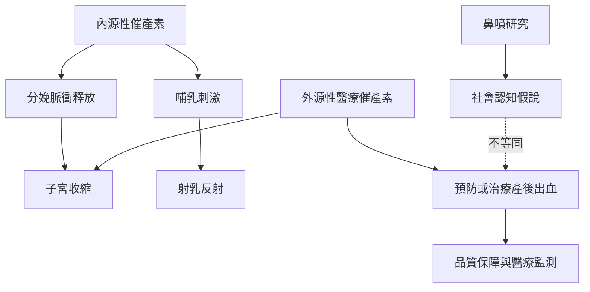

催產素在分娩子宮收縮、射乳反射與產後出血預防及治療中有明確臨床角色。這些用途具有專業指引與醫療監測要求，與鼻噴催產素提升社交能力的研究屬於不同證據領域。公共衛生亦須關注藥品質量、供應與可近性。

核心概念：[[催產素]]、[[子宮收縮]]、[[射乳反射]]、[[產後出血]]、[[腦下垂體後葉]]、[[周邊催產素]]。

延伸筆記：[[催產素透過子宮收縮與射乳反射發揮重要周邊功能]]、[[催產素的臨床用途不等於社會增益療法]]。
