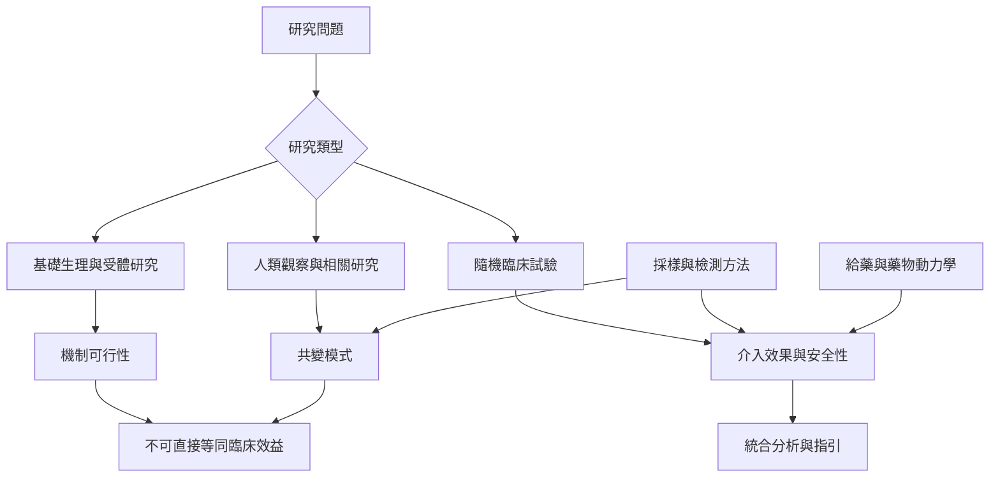

催產素社會行為研究常見的限制包括測量樣本來源、檢測方法、給藥吸收、劑量差異與研究設計異質性。證據評估必須連結研究問題與方法：周邊濃度不等於中樞活動，相關不等於因果，單項試驗也不等於臨床療效。

核心概念：[[周邊催產素]]、[[中樞催產素]]、[[鼻腔給藥]]、[[藥物動力學]]、[[臨床試驗]]、[[統合分析]]、[[催產素測量方法會改變研究結論]]。

延伸筆記：[[社會互動研究必須區分相關與因果]]、[[周邊催產素濃度不能直接代表腦內催產素活動]]、[[鼻噴催產素的臨床效益尚未穩定確立]]。
