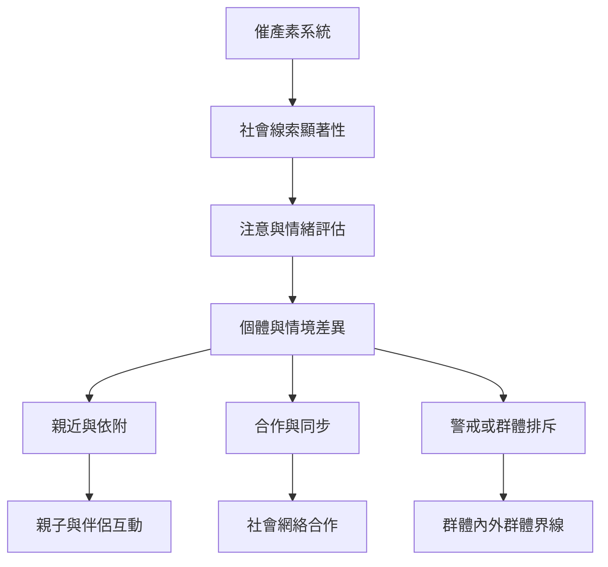

催產素在人類社會行為中的作用不是固定的親社會效果，而可能涉及社會線索顯著性、情緒評估、獎賞處理與互動同步。親子關係、伴侶關係與群體合作的研究提供不同層次的線索，必須保留相關與因果、動物與人類、個體與制度之間的界線。

核心概念：[[社會顯著性]]、[[依附]]、[[親子依附]]、[[社會同步]]、[[群體內外群體]]、[[草原田鼠模型]]、[[多巴胺]]。

延伸筆記：[[催產素的社會效果會受到情境與個體差異調節]]、[[催產素更像社會線索的增益器而非道德加速器]]、[[浪漫關係不能化約為催產素的濃度]]、[[親社會傾向不能取代互助制度的設計]]。
