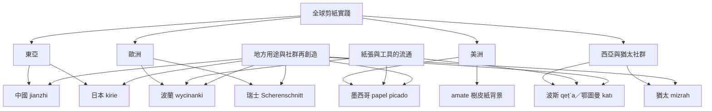

本地圖以地方實踐為核心，將不同地區的剪紙傳統並列，而不預設它們都源自單一技法。可比較紙材如何移動、地方工匠如何改造工具、作品如何進入節慶或宗教生活，以及哪些歷史關係有可靠證據。

概念連結：[[剪紙]]、[[中國剪紙]]、[[日本切繪]]、[[墨西哥剪紙旗幡]]、[[波蘭民俗剪紙]]、[[瑞士剪影剪紙]]、[[波斯紙雕剪紙]]、[[猶太祈禱方向剪紙]]、[[阿瑪特樹皮紙]]。

研究提醒：[[跨文化傳播不是單向起源故事]]；每項傳播主張都應標示其證據類型與不確定性。

回到導讀：[[Papercutting]]
