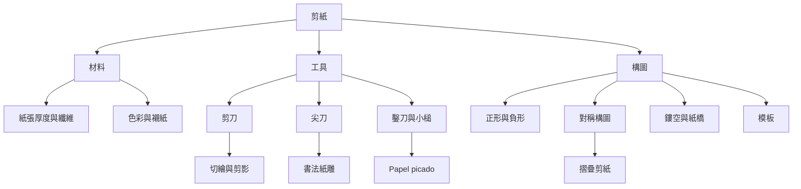

本概念地圖聚焦剪紙如何從材料和工具出發，形成可辨識的視覺語法。剪刀、尖刀、鑿刀與摺紙方法會改變線條、鏤空、紙橋和對稱性；正形與負形則共同構成圖像。當模板被用於染色或重複轉印時，剪刻紙張也可能成為一種生產工具，而不只是最終作品。

概念連結：[[剪紙]]、[[中國剪紙]]、[[日本切繪]]、[[折紙剪紙]]、[[墨西哥剪紙旗幡]]、[[波斯紙雕剪紙]]、[[正形與負形]]、[[對稱構圖]]、[[模板與鏤空]]、[[紙本保存]]。

進一步閱讀：[[剪紙透過正負形把空白轉化為敘事]]、[[摺疊讓對稱成為可重複的構圖工具]]、[[紙張與刀具共同決定剪紙的語彙]]。

回到導讀：[[Papercutting]]
