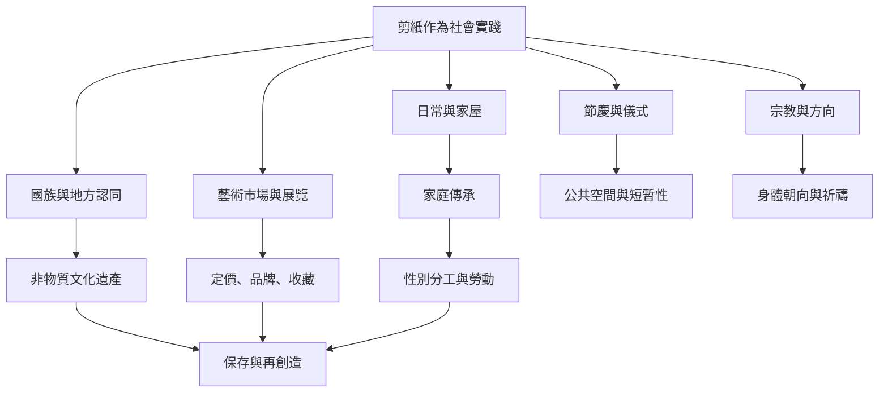

剪紙既是形式技術，也是社會關係的一部分。它可以裝飾家屋、標示宗教方向、懸掛於節慶空間、傳遞家族記憶、表達地方認同，亦可能成為國家文化政策、觀光經濟、展覽制度與市場品牌的對象。本地圖把作品用途、性別勞動、文化遺產化與市場協商放在同一脈絡中觀察。

概念連結：[[非物質文化遺產]]、[[民藝]]、[[猶太祈禱方向剪紙]]、[[墨西哥剪紙旗幡]]、[[中國剪紙]]。

延伸筆記：[[剪紙的儀式意義來自它被放置的關係]]、[[民藝的女性勞動不應被浪漫化]]、[[非遺保存的核心是讓實作者持續作決定]]、[[剪紙風格由社群制度與市場共同塑造]]、[[剪紙的短暫性也是作品意義的一部分]]。

回到導讀：[[Papercutting]]
